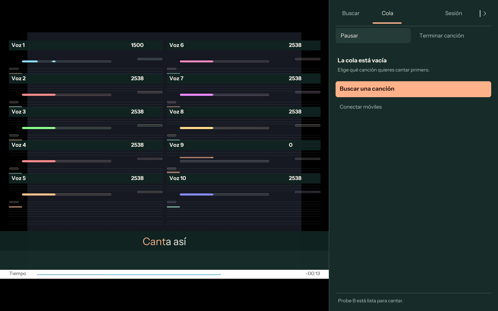

# Retorno, trazo y puntuación por entrada

Mediciones del 21 de noviembre de 2026 en un MacBook Pro M4 con macOS 26.6.2. El micrófono y los altavoces integrados estaban a 48 kHz. El volumen del sistema era del 44 % y la entrada, del 27 %. El anfitrión puede medir su propio equipo desde **Sesión → Cantantes → Calibrar esta entrada → Medir recorrido con pulsos**. La voz sigue puntuando con el retorno silenciado.

## Altavoz y micrófono reales

La app emitió siete pulsos de 32 ms a través de cada configuración de salida y buscó su envolvente a 1.700 Hz en el micrófono. La tabla recoge la mediana por configuración y la diferencia entre el mayor y el menor retardo observado. Se midió el tiempo desde entregar audio a la salida hasta recuperar la señal acústica en la entrada. Para atribuir el retraso únicamente al retorno de la voz hace falta medir su salida amplificada con una grabadora externa y una referencia independiente.

| Recorrido | Bloque de salida pedido a SDL | Mediana | Dispersión | Pulsos reconocidos |
| --- | ---: | ---: | ---: | ---: |
| Mezclador SDL | 2.048 | 144 ms | 1 ms | 7 de 7 |
| Mezclador SDL | 512 | 91 ms | 1 ms | 7 de 7 |
| Mezclador SDL | 256 | 96 ms | 5 ms | 7 de 7 |
| Mezclador SDL | 128 | 96 ms | 8 ms | 7 de 7 |
| PortAudio dúplex, voz directa desde el callback | Independiente del mezclador de música | **72 ms** | **0 ms** | **7 de 7** |

El tamaño más pequeño solicitado a SDL no produjo la menor latencia física. En este Mac el recorrido dúplex redujo en 19 ms la mediana frente a SDL con 512 muestras. El objetivo físico propuesto de 20 ms sigue pendiente. Faltan una interfaz USB con micro por cable, mediciones físicas en Windows y una prueba de 30 minutos con retorno real. La calibración conserva únicamente resúmenes de energía en memoria y rechaza una señal ambigua. Silencio y ruido sin pulsos se rechazaron a 44,1 y 48 kHz. La prueba determinista recuperó retardos conocidos de 0, 50, 100 y 200 ms en ambas frecuencias. El tiempo acústico se muestra como diagnóstico. El ajuste manual de puntuación conserva su propio valor.

El motor intenta abrir la entrada y la salida a la vez con PortAudio en CoreAudio. El retorno usa la ganancia de cada voz y se suma en el mismo callback. Si el equipo rechaza el dúplex, prueba la entrada con retorno por el mezclador SDL. El modo estable se puede ensayar con `KARAOKE_MONITOR_PATH=mixer` y `KARAOKE_AUDIO_BLOCK=2048` al arrancar desde una terminal. Windows conserva su ruta SDL de captura y salida. El dispositivo de salida se identifica mediante el UID de CoreAudio o el endpoint WASAPI cuando el controlador lo permite. En otros controladores se consulta el nombre de la salida predeterminada informado por SDL. [Consulta de salida de SDL](https://wiki.libsdl.org/SDL2/SDL_GetDefaultAudioInfo) · [Tiempos de captura de PortAudio](https://files.portaudio.com/docs/v19-doxydocs/structPaStreamCallbackTimeInfo.html)

En una prueba adicional, los altavoces del Mac reprodujeron cuatro segundos de La4 sintetizado mientras la entrada real permanecía activa y el retorno silenciado. Al volumen descrito, el pico captado fue **0,93 % de escala**, las quince lecturas fueron de silencio puntuable y el marcador quedó en **0**. PortAudio informó de 4 ms entre la primera muestra de entrada y el callback y de 5 ms entre el callback y la salida DAC. Son cifras del controlador y no sustituyen el resultado acústico de 72 ms. Otros micrófonos, la distancia al altavoz, el volumen o una grabación vocal cambian la filtración y requieren su propia prueba.

## De la entrada al trazo

El banco inyectó PCM a 48 kHz en el motor y midió dentro del renderizador cuándo apareció la clase de nota correcta. Hizo tres recorridos de once tonos desde Do2 hasta Sol5. La segunda detección consecutiva confirmó la primera. Con el controlador SDL de prueba, en 33 transiciones el primer trazo acertado tardó **18 ms de mediana, 36,4 ms en p95 y 53 ms en el peor caso**. La confirmación de dos dibujos tardó 90,2 ms en p95. Estos tiempos empiezan al activar la entrada de prueba en el motor y terminan al preparar el trazo. La captura física, la red de un teléfono y el refresco de un televisor suman sus propios retardos.

Al probar el registro grave, la comparación circular anterior clasificó un Mi2 sostenido como Do. Ahora el detector compara únicamente muestras superpuestas y normaliza la diferencia para los 49 tonos. El análisis de la ventana reciente de 2.048 muestras se ejecuta fuera del bloqueo de captura. Con un solo cantante y con dos, la comparación de fotogramas verificó el trazo al desafinar hacia arriba y hacia abajo, silencio, nota acertada y voz sostenida durante un descanso.

## Compensación y multijugador

Dos fuentes independientes pueden tener distinto retraso. El ajuste temporal de cada una se aplica antes de redondear el tiempo al pulso de partitura. El control de precisión se refiere a la desviación en semitonos y sigue siendo independiente del volumen de retorno. En una ronda de siete voces sobre una secuencia de La4 y Do5, con compensaciones de 0, +50, +100, +200, −50 y −100 ms, las puntuaciones fueron **9.896, 9.896, 10.000, 10.000, 9.792 y 9.792** sobre 10.000. La séptima voz recibió la misma señal con +200 ms y sin corrección, y obtuvo 208. La diferencia máxima frente a la referencia compensada fue de 104 puntos. Una repetición después de corregir la detección en el registro grave obtuvo 10.000 en las seis voces corregidas y 0 en el control desfasado. Al introducir el receptor de audio independiente se repitieron los seis 10.000 y el control desfasado obtuvo 208.

Se ejecutaron actuaciones de **1, 2, 3, 5, 6 y 10 cantantes** con la ventana nativa real. La mitad de las entradas simulaban micrófonos físicos y las demás enviaban PCM por el transporte privado del host. En la ronda de diez, una voz desafinada obtuvo cero mientras las otras nueve puntuaban. También se comprobaron una desconexión y reconexión durante la nota, paquetes repetidos y de una actuación anterior, una ruta física duplicada y la liberación de reservas al terminar. Este banco comprueba diez voces digitales independientes. Diez teléfonos, diez conversores reales y las condiciones de una fiesta requieren pruebas físicas adicionales.



## Recepción continua de móviles

Un primer ensayo de 20 minutos procesó cinco emisores de paquetes de voz y cinco entradas sintéticas locales, con cambios de panel y búsquedas periódicas. La versión que leía el socket desde el dibujo dejó **249–250 huecos de secuencia en unos 60.000 paquetes por emisor** bajo carga. Un segundo ensayo de 90 segundos con la salida real de CoreAudio observó 34 huecos por emisor sin interrupciones. Las muestras del mando ahora se reciben en un hilo dedicado que verifica la actuación, el cantante y la secuencia, y se une al cerrar antes de liberar la entrada. La puntuación sigue en el hilo del juego y la ganancia de retorno usa el mezclador de voz.

## Paquete de Windows

La ejecución de GitHub Actions en Windows Server 2022 produjo el paquete x64 y arrancó el ejecutable congelado. En una copia con Mesa por software y audio SDL dummy se verificaron arranque, cierre, notas dibujadas, tres precisiones, desconexión, grupo de diez, compensación por entrada y gestión de la cola por varios navegadores. El controlador de pruebas utilizó la biblioteca de soporte GCC suministrada con el producto y registró su huella. El artefacto de esa ejecución corresponde al commit `f58a5d3`, previo al cambio de hilo de recepción y a la última revisión del detector. [Ejecución de Windows](https://github.com/AlexAmMo/karaoke/actions/runs/44900315207)

## Reproducción

Desde la raíz del repositorio con el motor compilado, `RUTA_MOTOR` representa el ejecutable de Deluxe modificado. Cada ejecución usa datos temporales. Las pruebas de PCM sintético usan SDL dummy y pueden abrir una ventana real.

```sh
mkdir -p build/audio-qa
fpc -Fu./native -FUbuild/audio-qa -FEbuild/audio-qa scripts/test_audio_calibration.pas
build/audio-qa/test_audio_calibration
uv run python scripts/test_trace_response.py --engine RUTA_MOTOR --output build/audio-qa/tiempos.json
uv run python scripts/test_group_audio.py --engine RUTA_MOTOR --output build/audio-qa
uv run python scripts/test_pitch_precision.py --engine RUTA_MOTOR
uv run python scripts/test_live_pitch.py --engine RUTA_MOTOR --output build/audio-qa/afinacion
uv run python scripts/soak_group_audio.py --engine RUTA_MOTOR --seconds 1200 --output build/audio-qa/sostenida.json
```
