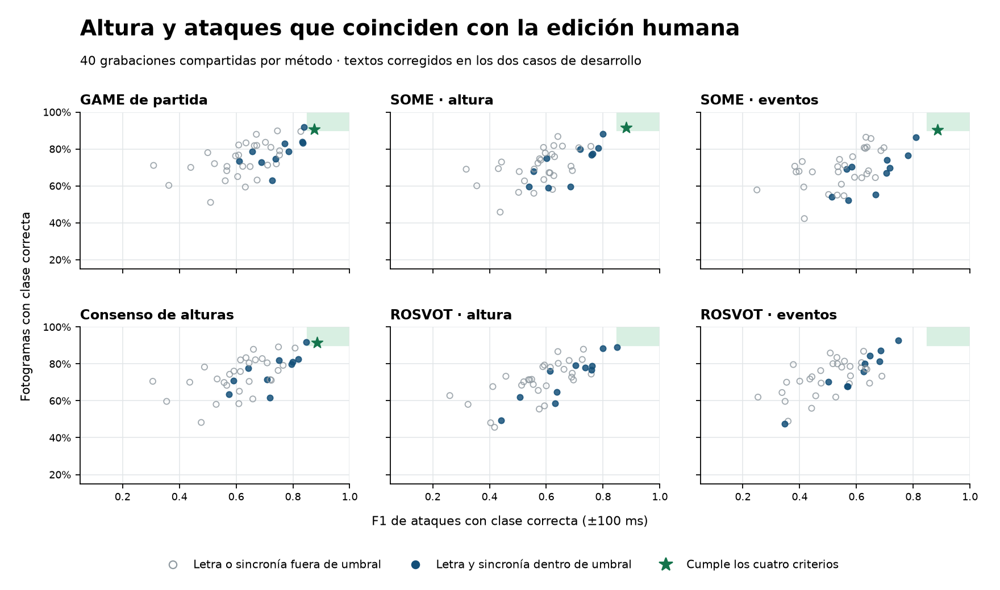

# ¿Qué oye el generador cuando alguien canta?

Una barra puntuable necesita una altura y dos tiempos en el reloj de la grabación. Una vocal con vibrato puede ser una sola nota, una palabra puede abarcar varias notas y dos sílabas consecutivas pueden repetir la misma altura. Un detector de frecuencia fundamental por sí solo no distingue todos esos casos. En el estudio de transcripción con Tony, los autores separan los errores de entonación, detección de voz y límites de nota. Un estudio posterior con varias personas transcribiendo la misma interpretación documenta desacuerdos en los portamentos y en los límites entre notas. La evaluación MIREX de transcripción de canto también distingue la melodía por fotograma de las notas y admite 100 ms de tolerancia en el ataque. [Tony](https://www.tenor-conference.org/proceedings/2015/04-Mauch-Tony.pdf) · [Estudio de segmentación entre anotadores](https://journal.iftawm.org/previous/2025-volume-13-no-2/proutskova-2025/) · [Protocolo MIREX](https://music-ir.org/mirex/wiki/2020:Singing_Transcription_from_Polyphonic_Music)

## Resultados por grabación

Se compararon **las mismas 40 grabaciones completas**, veinte en inglés y veinte en español. Cada cifra es la mediana por canción. La comparación principal conserva los borradores de texto de partida. Se evaluaron por separado los dos textos corregidos durante esta iteración. [Resultados SOME](melodia-some.csv) · [Resultados ROSVOT y consenso](melodia-rosvot.csv) · [Dos variantes con texto corregido](melodia-cambios-letra.csv)

| Método | Fotogramas cubiertos | Clase correcta sobre todos los fotogramas | F1 de ataque admitiendo cualquier altura | F1 exigiendo ataque y altura |
| --- | ---: | ---: | ---: | ---: |
| Borrador base (GAME) | 96,05 % | 76,48 % | 0,818 | 0,668 |
| SOME, solo cambia altura | 96,05 % | 71,52 % | 0,818 | 0,608 |
| SOME, reconstruye los eventos | 96,26 % | 68,70 % | 0,798 | 0,585 |
| ROSVOT, solo cambia altura | 96,05 % | 72,21 % | 0,818 | 0,606 |
| ROSVOT, reconstruye los eventos | 97,72 % | 74,67 % | 0,748 | 0,540 |
| Acuerdo entre SOME y ROSVOT | 96,05 % | 75,97 % | 0,818 | 0,646 |

En la figura, cada punto representa una canción. Se usan los textos corregidos de *Amorfoda* y *Northern Star* para mostrar qué pasa al mejorar también la letra. La zona verde reúne las dos condiciones musicales. Las estrellas cumplen además los dos requisitos de letra y sincronización.



**La mayoría de los fallos de altura aparecen mientras ya hay una barra.** En la base, dando el mismo peso a cada canción, el 75,5 % del tiempo de referencia coincide en clase, el 6,9 % queda a un semitono, el 12,2 % se desplaza dos o más y el 5,4 % queda sin barra puntuable. Ignorando la altura por completo, 23 de las 40 grabaciones aún no alcanzarían el F1 de ataques de 0,85 conservando los límites existentes. Hacen falta mejores decisiones de segmentación además de un mejor detector de tono.

El MIDI acústico de ROSVOT cubre el 99,24 % de los fotogramas de referencia y logra una clase mediana del 77,53 %. Su F1 de ataque y clase es 0,491 antes de asignarle letra. Reconstruir con las sílabas eleva ese F1 a 0,540. En *Amorfoda*, con la letra corregida, la reconstrucción ROSVOT obtiene 92,81 % de clase y F1 de 0,7471. El modelo puede acertar la altura durante una vocal larga y dividirla en un número de barras distinto al esperado por el juego.

Con los textos de partida ningún ensamblado cumple los cuatro requisitos en las 40 grabaciones. Al usar los subtítulos verificados de *Amorfoda*, GAME llega a 90,61 % de clase y 0,8756 de F1. El consenso llega a 91,45 % y 0,8844, con WER del 1,38 % y p90 de 63 ms. Se trata de **una misma canción** y fue un caso de desarrollo. En *Northern Star*, después de corregir la letra, el consenso llega a 91,94 % de clase, WER del 3,37 % y p90 de 67 ms, pero el F1 permanece en 0,8474 frente al mínimo 0,85. Esta prueba no respalda sustituir GAME por ninguno de estos dos motores de forma general.

Los runners intentaron recuperar siete vídeos españoles directamente de YouTube. En los siete casos el proveedor pidió identificación antes de descargar audio. Esas siete inferencias ROSVOT y la última de SOME se completaron en el Mac sobre los WAV de voz que ya estaban vinculados al máster exacto. La tanda se ejecutó en CPU con un solo modelo activo y tres hilos. Los tiempos de los modelos excluyen la separación de la voz y la obtención de la letra. La columna de tiempo mide el trabajo bajo la carga real del ensayo y no permite una comparación uniforme de velocidad entre máquinas. [Prueba de las siete fuentes originales](https://github.com/AlexAmMo/karaoke/actions/runs/44918586017)

## Modelos investigados

| Sistema | Aportación para Karaoke | Evidencia y distribución |
| --- | --- | --- |
| GAME | Contraste de producción. Admite predicción acústica y condicionamiento por límites de palabra. Una mala marca de palabra puede partir una vocal o unir dos sílabas. | Código MIT. Hay que distinguir cada checkpoint de su implementación. [Repositorio de OpenVPI](https://github.com/openvpi/GAME) |
| SOME | Antecesor de GAME. Predice fronteras y distribuciones de altura con un modelo para voz cantada. Probamos el checkpoint oficial de cinco voces. | Código MIT, pesos de este ensayo **CC BY-NC-SA 4.0**. La evaluación no incorpora esos pesos al instalador. [Código](https://github.com/openvpi/SOME/tree/e523eef70777c1370199363de03eb37d66dce76e) · [Condiciones de los pesos](https://github.com/openvpi/SOME/releases/tag/v1.0.0-baseline) |
| ROSVOT | Sistema independiente. RMVPE extrae el tono, RWBD estima límites de palabra y ROSVOT predice límites de nota y altura. Tiene entrenamiento para soportar ruido. Los pesos publicados se entrenaron solo con el conjunto mandarín M4Singer. Probar EN y ES resulta imprescindible. | Código original MIT. La distribución Soul-AILab declara Apache-2.0 para el repositorio y el port identifica expresamente los tres componentes. Las dos licencias deben atribuirse a su artefacto. [Artículo ACL](https://aclanthology.org/2024.acl-long.526/) · [Implementación original](https://github.com/RickyL-2000/ROSVOT/tree/3c8332bf43adae35f6e4d64971862f2f6139b310) · [Pesos](https://huggingface.co/Soul-AILab/SoulX-Singer-Preprocess/tree/83dc50289d22a81b1e9998f5b9e111aef7c1fdcd/rosvot) · [Avisos del port](https://github.com/0xShug0/audio.cpp/blob/cf4929424ac27e487d09fb64702c72681cc18ba8/tests/rosvot/NOTICE) |
| VOCANO | Combina una red para altura y otra entrenada con aprendizaje semisupervisado para segmentación. Sus autores recomiendan quitar el acompañamiento y muestran ejemplos con Demucs. | Candidato de investigación. El entorno publicado se probó con CUDA 10.1. La comparación medida de esta iteración se centra en SOME y ROSVOT. [Código, publicación y ejemplos](https://github.com/B05901022/VOCANO) |
| STARS | Trata conjuntamente transcripción, alineación de fonemas y estilo. Es interesante cuando letra y notas se desajustan en una misma frase. | Los modelos publicados son chino y chino-inglés. La configuración bilingüe define un inventario explícito de fonemas. Evaluar español exige abordar ese inventario y validar sus tiempos. [Implementación y checkpoints](https://github.com/gwx314/STARS) |

Un límite distinto aparece si la voz aislada contiene dos cantantes a la vez. HTDemucs entrega una pista “vocals” con las voces presentes. Para puntuar una sola melodía todavía queda decidir a quién seguir en un coro o un dúo. MedleyVox separa precisamente las tareas de unísono, dúo y voz principal frente al resto. Es una posible línea para los fallos en armonías. En esta comparación todos los métodos reciben la misma pista vocal, de modo que cualquier cambio medido procede del transcriptor o del ensamblador. [HTDemucs](https://github.com/facebookresearch/demucs) · [MedleyVox, ICASSP 2023](https://arxiv.org/abs/2211.07302)

## Comparación trazable

Se usan las mismas 40 grabaciones completas de la versión 0.3, sus 40 referencias, el separador HTDemucs de producción y el reloj original. El índice privado vincula cada mezcla por SHA-256. Se reutilizan las voces con identidad y duración comprobadas. El generador de eventos musicales solo recibe esas voces aisladas. El siguiente paso usa letra y tiempos ya predichos por Karaoke. Se guarda la huella de cada mapa resultante antes de que el evaluador abra el mapa humano. Se volvió a medir el borrador base realmente usado para cada alternativa. Los 20 TXT españoles y 14 de los 20 ingleses coinciden byte a byte con la versión anterior. Los seis restantes se recuperaron regenerándolos en Windows sobre la grabación de huella verificada. Toda diferencia entre métodos se calcula respecto al mismo borrador de esta comparación. [Muestra de referencia](generacion-muestra.json) · [Métricas de la versión anterior](generacion-resultados.csv)

Trece grabaciones inglesas de los paquetes Creative Commons se distribuyeron en runners Linux. Cada runner verificó el SHA-256 del máster, separó la voz una vez con HTDemucs en CPU y ejecutó ROSVOT sobre esa voz. La transferencia de vuelta usó cifrado autenticado y un certificado de destinatario cuya clave privada permaneció en el Mac. Se volvió a comprobar el SHA-256 del WAV antes de introducirlo en el índice compartido. SOME, ROSVOT y las pruebas de tiempos utilizan exactamente ese mismo fichero por canción. *Monkey Shines* se repitió como control Mac/runner conservando la voz original del Mac para la matriz principal. Cada WAV tenía 2.252.160 muestras por canal a 44.100 Hz. La diferencia fue de 8,73 × 10⁻⁸ RMS y 1,14 × 10⁻⁶ de pico con amplitud normalizada, y los 121 tríos inicio, final y altura de ROSVOT coincidieron exactamente después de serializarlos a seis decimales. La rama de ensayo contiene los scripts y el certificado público. [Matriz de cálculo](https://github.com/AlexAmMo/karaoke/actions/runs/44916487502)

- **Altura sobre las barras originales** conserva sílabas, ataques y finales. Cambia la altura únicamente si una misma nota del modelo alternativo ocupa al menos la mitad de la barra. Mantiene las decisiones de estilo libre del borrador.
- **Reconstrucción con eventos** recupera cada sílaba prevista, incluidas sus prolongaciones. Aplica el mismo ensamblador de Karaoke a los nuevos ataques y alturas. Una sílaba sin evidencia musical queda libre. Una sola vocal puede abarcar varias barras.
- **Consenso de alturas** conserva ritmo y freestyle del borrador. Solo corrige la clase cuando SOME y ROSVOT coinciden entre sí y cada uno respalda su altura durante al menos la mitad de la barra. Si hay acuerdo de clase en octavas distintas se conserva la propuesta más próxima al registro del borrador.
- **Solo eventos** compara el MIDI acústico con los objetivos humanos sin introducir letra ni anclaje a sílabas. Sirve para localizar errores de segmentación anteriores al ensamblado. Carece de WER, sincronización de letra y candidatura a puntuación de la canción completa.

Los tres ensamblados se fijaron antes de consultar las métricas de la comparación entre modelos. Ambos motores reciben ventanas con 18 s centrales y 2 s de contexto a cada lado. Cada nota pertenece a la ventana que contiene su punto medio. Los solapamientos conflictivos se resuelven en el punto medio de la intersección y se conserva el eje temporal original. La comparación usa clase de nota módulo 12 cada 10 ms sobre **todos** los fotogramas puntuables de referencia, incluidos los omitidos. El F1 empareja ataques una sola vez, con la misma clase y una tolerancia de 100 ms. Una canción debe cumplir simultáneamente WER ≤5 %, p90 de comienzo de palabra ≤120 ms, clase ≥90 % y F1 ≥0,85. Es una prueba retrospectiva con una sola edición humana por grabación.

## Reproducción

Se necesita el entorno de generación, el manifiesto privado de grabaciones de la versión anterior y los TXT previamente producidos o regenerados sobre esos mismos másteres. Las rutas de voces y borradores son índices JSON privados con forma `{"id": "/ruta/absoluta"}`. En este ensayo el port ROSVOT contiene los pesos F32 y ejecuta las ventanas de una grabación en un lote para compartir la carga del modelo. El ejecutable publicado v0.9.5 carece de esta familia. Se compiló el commit `cf4929424ac27e487d09fb64702c72681cc18ba8` con `AUDIOCPP_MODEL_SET=custom`, `AUDIOCPP_MODELS=rosvot` y destino `audiocpp_cli`. En un control vocal de seis segundos la salida JSON de CPU y Metal tuvo el mismo SHA-256. En los 51 s completos de *Monkey Shines*, CPU y Metal produjeron 121 eventos en el mismo orden con todas las alturas iguales. Un límite entre dos eventos difirió en un fotograma (5,33 ms). El decodificador del modelo SOME emplea el espectrograma, red y decodificador originales, con la selección del núcleo de atención adaptada a Metal. [Port y documentación](https://github.com/0xShug0/audio.cpp/blob/cf4929424ac27e487d09fb64702c72681cc18ba8/docs/models/rosvot.md) · [Validación de paridad del port](https://github.com/0xShug0/audio.cpp/blob/cf4929424ac27e487d09fb64702c72681cc18ba8/tests/rosvot/README.md) · [Pesos convertidos](https://huggingface.co/audio-cpp/SoulX-Singer-GGUF/tree/ded36295f789661e590e4bf6ad49a25470cf830d/ROSVOT-GGUF)

```sh
python scripts/experiments/melody_stems.py corpus.json docs/validation/generacion-resultados.csv HTDemucs.safetensors shared
python scripts/experiments/melody_transcribe.py some modelo.ckpt shared/stems.json eventos/some --source /ruta/a/SOME --device mps --expect 40
python scripts/experiments/melody_transcribe.py rosvot rosvot-f32.gguf shared/stems.json eventos/rosvot --binary /ruta/a/audiocpp_cli --device cpu --expect 40
python scripts/experiments/melody_compare.py generate eventos/some shared/charts.json mapas/some
python scripts/experiments/melody_compare.py generate eventos/rosvot shared/charts.json mapas/rosvot --agree-with eventos/some
python scripts/experiments/melody_compare.py measure eventos/some shared/charts.json mapas/some corpus.json docs/validation/generacion-resultados.csv melodia-some.csv
python scripts/experiments/melody_compare.py measure eventos/rosvot shared/charts.json mapas/rosvot corpus.json docs/validation/generacion-resultados.csv melodia-rosvot.csv --agree-with eventos/some
```

SOME necesita el fichero `config.yaml` original junto al checkpoint, además de PyTorch, NumPy, librosa, einops, PyYAML y mido. La conversión a 24 kHz para ROSVOT usa soxr HQ. El hash del checkpoint se comprueba antes de inferir. El entorno del ensayo y el instalador de la aplicación son independientes.
